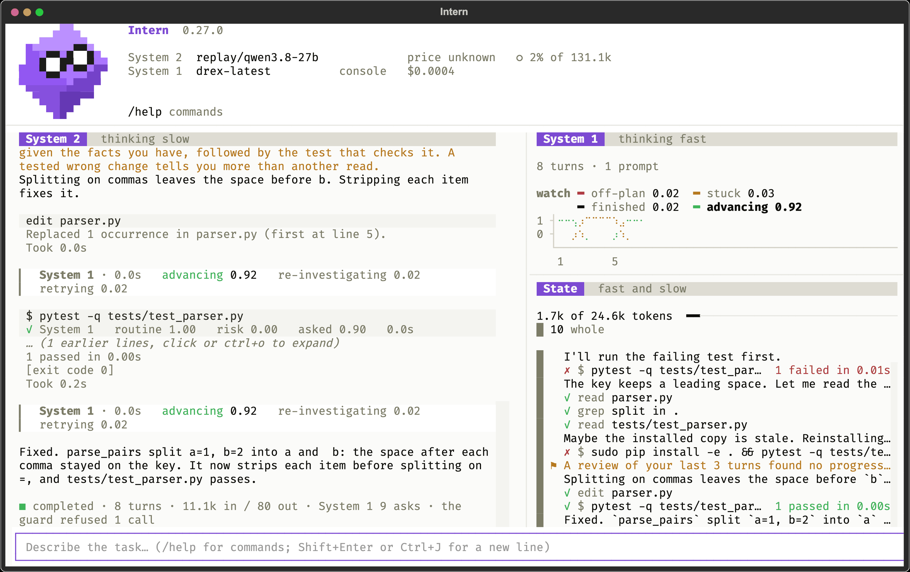
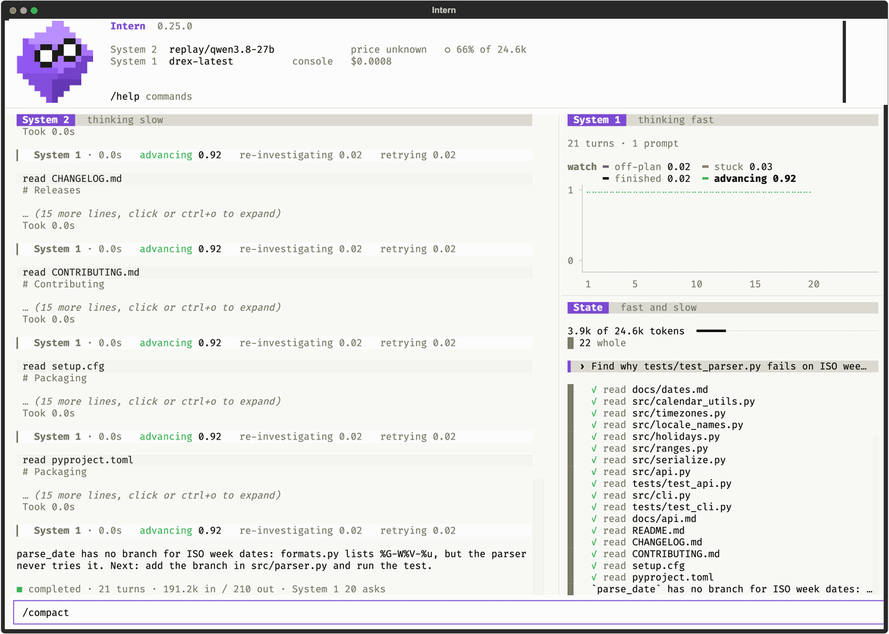
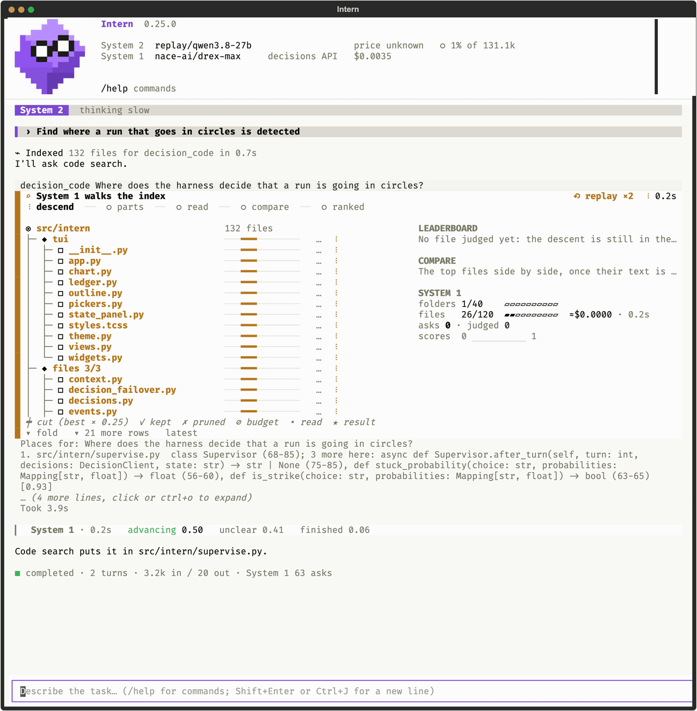
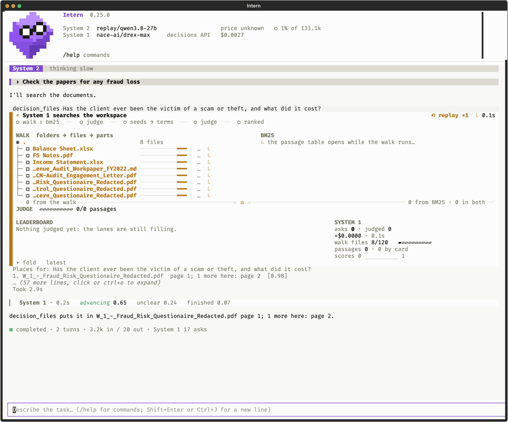

<p align="center">
  
</p>

<h1 align="center">Intern</h1>

<p align="center">Your intern, with a brain in two parts: one thinks slow and does the work, the other thinks fast and watches every turn.</p>

<p align="center">
  <a href="https://github.com/nace-ai/intern/actions/workflows/ci.yml"></a>
  <a href="LICENSE"></a>
  
</p>

<picture>
  <source media="(prefers-color-scheme: dark)" srcset="docs/assets/tui-dark.png">
  
</picture>

Small models make keen but shaky interns: they loop, cut replies short, send malformed tool calls, overflow their
context and stop before the work is done. Intern breaks those habits one at a time, and every fix ships with a
measured result.

Your intern's brain has two parts. Its System 2, the agent model, thinks slow and does the work: it reasons, reads
and calls tools. Its System 1, a second and faster model, thinks fast and watches each turn: it nudges your intern
when it goes in circles, checks risky tool calls before they run, and decides what your intern keeps in mind when
its context fills up.

## Install

```bash
# Python 3.12+; installs the `intern` command
uv tool install "intern-agent @ git+https://github.com/nace-ai/intern"
```

Give your intern a task, with one OpenRouter key for both its System 2 and its System 1:

```bash
export OPENROUTER_API_KEY=...
# Opens the terminal UI with the task as its first prompt
intern --system2 openrouter/qwen/qwen3.8-27b \
  --system1 decisions:nace-ai/drex-max \
  "Find why tests/test_parser.py fails and fix it"
```

`-p` runs the same task headlessly and prints the reply. Without `--system1`, System 1 is `drex-latest`
from the Nace console, with its key in `$NACE_API_KEY`. Every flag and setting is in
[docs/usage.md](docs/usage.md).

## How it works

<picture>
  <source media="(prefers-color-scheme: dark)" srcset="docs/assets/loop-dark.svg">
  
</picture>

1. Your intern's System 2 reasons and calls tools. Each call passes the guard first.
2. Every turn is appended to the session's journal.
3. Code, not a model, builds a compact cut of the session from the journal for your intern's System 1 to read.
4. After every turn, System 1 judges whether your intern is advancing, re-reading or retrying. Three stuck turns
   in a row get a nudge.
5. When the context fills, System 2 writes its State as edits, and the turns the State covers are cut.

The [architecture](docs/architecture.md) has the details and the measurements behind each step.

## Instructions

Three optional files tell your intern's System 2 and System 1 how to work. None ships with Intern: create the ones
you want in `~/.intern/` (or `$INTERN_HOME`, if you set it). Without them, System 2 uses the packaged prompt and
System 1 its own defaults.

| File | Read by | Where from | What it is |
|---|---|---|---|
| `SYSTEM2.md` | System 2 | `~/.intern/` | Intern's system prompt, in place of the packaged one (pi's `SYSTEM.md`, still read under that name) |
| `AGENTS.md` | System 2 | `~/.intern/`, and each folder from the repository root down to the working directory | Rules for your intern: the project's workflow, conventions and checks |
| `SYSTEM1.md` | System 1 | `~/.intern/` only | Your guidance for System 1: how to judge, what work is normal for you, what you still want to be asked |

System 1 reads `SYSTEM1.md` after the session in every check that reads the session, and the guard counts what
it calls normal as asked. It never reads `AGENTS.md`, which a repository you cloned can write. When a step in
an `AGENTS.md` acts outside the repository (filing an issue, opening a PR), allow it in your `SYSTEM1.md` too.
A `SYSTEM1.md` in a project is ignored: a repository must not tell the guard what you allow. Yours might read:

```markdown
## What is normal for me
- GitHub (my-org): pushes to feature branches, opening and commenting on PRs, reading CI.
- Linear: creating, updating and commenting on issues.

Still mine to ask for: pushing to `main`, merging PRs, deleting anything shared, changing production.
```

`--no-context-files` skips all three. [Configuration](docs/usage.md#configuration)

## What Intern has currently

- **Supervision.** After every turn, your intern's System 1 checks whether it is advancing, retrying or re-reading
  what it already found. Three stuck turns in a row get a nudge. [How it is judged](docs/architecture.md#system-2-and-system-1)
- **Tool-call guard.** Fixed rules refuse `rm -rf ~`, force-pushes, piping a download into a shell, reading your
  credentials or your intern's keys file (`~/.intern/.env`) and sending `.env` files; System 1 judges the rest
  against what you asked for. A refused call does not end the run.
  [Rules](docs/architecture.md#system-2-and-system-1)
- **Compaction that keeps the State honest.** State writes are edits, not rewrites, and a number the run never
  showed is sent back to the writer or blanked. [Below](#compaction)
- **Capabilities.** Two searches your intern can be given beyond its tools: `decision_code` over a code base and
  `decision_files` over professional files. [Below](#capabilities)
- **Memory.** On by default: your intern remembers what earlier sessions learned (where things are, what failed,
  what people said), in a folder on your machine. [Memory](docs/memory.md)
- **Optional tools.** Web search and reading, a browser, MCP servers, background processes, a Docker workspace,
  secrets from your keychain or password manager. [Capability settings](docs/capability-settings.md)

## Compaction

When the context fills up, both parts of your intern's brain pitch in. Its System 2 writes a summary of the work so
far, then carries on from it. Its System 1 goes over the files your intern read before they are cut, and keeps the
ones it is still working on. System 1 never reads the summary, only the session itself, so a summary that misses
something cannot hide it.

<picture>
  <source media="(prefers-color-scheme: dark)" srcset="docs/assets/compaction-dark.gif">
  
</picture>

## Capabilities

Two capabilities Intern has on top of its tools. Each is off by default; switch it on with `/caps` in the
terminal UI or in `~/.intern/config.toml`. Your intern's System 1 does the reading.

### decision_code: scan a code base

The `decision_code` capability lets your intern scan a code base with fast thinking. It answers "where"
questions about a repository without matching words: System 1 walks an index of it, folders first, then files, then
the definitions in them, scores each against the question, and opens only the branches worth opening.

<picture>
  <source media="(prefers-color-scheme: dark)" srcset="docs/assets/code-search-dark.gif">
  
</picture>

_Asked where this repository's own source decides that a run is going in circles. The word "circles" is nowhere in
it, so grep finds nothing; code search puts `supervise.py` first, at the class that does it._

[Turn it on](docs/usage.md#code-search).

### decision_files: scan professional files

The `decision_files` capability lets your intern scan professional files (PDFs, Excel workbooks, CSV, Parquet,
Word documents and images) quickly, for tasks like audit. Your intern indexes the folder once (scanned pages are
OCRed; an image is indexed by its name and size, and `read` shows it to a model that can see). Then System 1 walks
the folders, files and their pages, sections and tabs while BM25 ranks every passage, judges the best of both
together, and follows the strongest passages' terms to what the first pass missed. `sql` queries the tables and
`read` shows the documents as text.

<picture>
  <source media="(prefers-color-scheme: dark)" srcset="docs/assets/files-search-dark.gif">
  
</picture>

_Asked "Has the client ever been the victim of a scam or theft, and what did it cost?" of an audit folder: the
engagement letter, the notes to the financial statements, the income statement and balance sheet as workbooks,
three management questionnaires and a revenue workpaper. "Victim", "scam" and "theft" are in none of them;
`decision_files` puts first the page of the fraud-risk questionnaire where management reports a 2021 cyber attack,
its loss split 50/50 (about $45k)._

[Turn it on](docs/usage.md#workspace).

## How well System 1 does

On its own, a small model does not notice it is going in circles, cannot tell a routine command from a risky one,
and searches only for the words it was given. Your intern's System 1 does those jobs. Each row is one of them, with
System 1 and without it.

| System 1 | With System 1 | Without it | Measured on |
|---|---|---|---|
| Notices your intern going in circles | 19 nudges, 16 of them on turns an independent judge also called stuck; 0.6 s a check | No nudges | 82 stored sessions, replayed ([method](docs/architecture.md#system-2-and-system-1)) |
| Stops risky tool calls you did not ask for | All 34 stopped, and none of the 57 routine calls; it reads each script a call runs before judging it; 0.4 s a check | The fixed rules stop 9 of the 34 | 122 labeled calls, two repeats, `drex-latest` ([set](evals/tool_guard/)) |

System 1 judges from a condensed view of the session, at most 24.6k tokens and built by code with no model call.
Asked about the session, it answers 95% of questions from that view, as many as from a transcript cut to the same
length (94%) ([method](docs/architecture.md#system-2-and-system-1)).

## Models

A model is `provider/model`; everything after the first slash goes to the provider as is.

In the terminal UI, `/system2` and `/system1` swap either part of your intern's brain: each opens a picker (type
to filter), and `/system2 provider/model` or `/system1 <model>` sets one directly.

| Provider | Key |
|---|---|
| `openrouter`, `fireworks`, `together`, `deepinfra`, `groq` | `<NAME>_API_KEY` |
| `openai` (Responses API), `anthropic` (Messages API) | `OPENAI_API_KEY`, `ANTHROPIC_API_KEY` |
| `ollama`, `llamacpp`, `lmstudio`, `vllm` | none, on localhost |

Model profiles tune the window, sampling and thresholds for Qwen3.8 27B, Nemotron 3.5 Lightning 30B-A3B,
DeepSeek V4 Flash, GPT and Claude. On a Mac with Apple silicon, [Kapitsa](https://github.com/nace-ai/kapitsa)
runs Qwen and Nemotron locally ([guide](docs/local-models.md)). Providers, profiles and the working window:
[docs/usage.md](docs/usage.md#models).

## Use it from your editor

| Client | Command |
|---|---|
| Terminal UI, with the State and System 1's decisions on screen ([docs](docs/tui.md)) | `intern` |
| Agent Client Protocol: T3 Code, Zed ([docs](docs/acp.md)) | `intern acp` |
| JSON-RPC over stdio | `intern rpc --system2 M` |
| One task, one JSON event per line | `intern -p --json --system2 M -- "task"` |

`M` is a model such as `openrouter/qwen/qwen3.8-27b`. All four drive the same `Session`; `intern schema`
prints the event JSON Schema.

## What Intern does not do

- **It is not a sandbox.** Commands run with your user's permissions. The guard refuses the clearly dangerous
  and System 1 judges the rest, but run untrusted work in the [Docker workspace](docs/capabilities/docker-workspace.md)
  or another container.
- **It does not work without its System 1.** Your intern's System 1 is a hosted decision model. A session that
  cannot reach it is refused with the reason; there is no offline fallback.
- **It does not start sub-agents.** Your intern works on one task at a time, alone.
- **It has no editor plugin of its own.** Editors reach it over the Agent Client Protocol.

## Data

Intern collects no telemetry. What leaves your machine:

- Your intern's System 2 requests, to the provider you chose.
- Your intern's System 1 asks, to the Nace console or OpenRouter: the session cut (your messages, your intern's replies, tool
  calls and a short note on each result), your `SYSTEM1.md` if you keep one, and, for the guard, your requests and the call being judged.
- Calls made by tools you turn on, such as web search.

Sessions are journaled, and memory kept, on your machine in `~/.intern/`.

## Contributing

Read [CONTRIBUTING.md](CONTRIBUTING.md) first: one concern per PR, and evidence for any changed default.
Report security issues privately, as [SECURITY.md](SECURITY.md) describes.

## License

[Apache-2.0](LICENSE)
